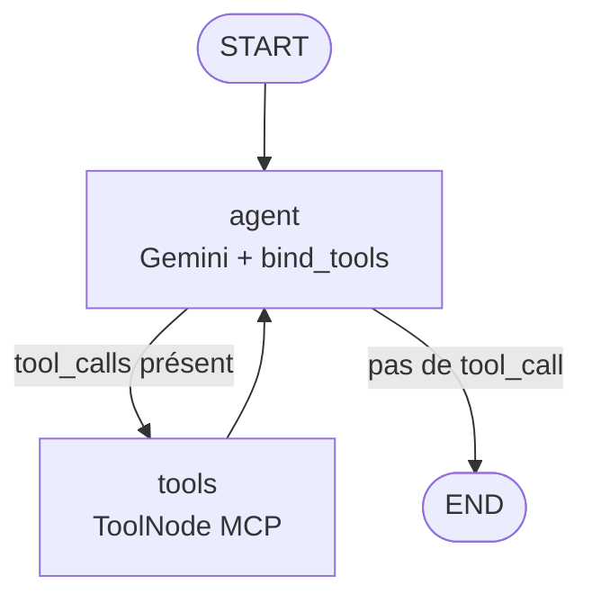

# Atelier LangGraph — agent de facturation

Agent conversationnel **ReAct** construit avec [LangGraph](https://github.com/langchain-ai/langgraph),
propulsé par **Google Gemini** et branché sur un serveur **MCP** de facturation (articles, clients,
règlements, anomalies).

L'agent ne contient aucune donnée métier : il découvre les outils exposés par le serveur MCP,
décide seul lesquels appeler, puis rédige une réponse en français à partir des observations reçues.

---

## Sommaire

- [Architecture](#architecture)
- [Prérequis](#prérequis)
- [Installation](#installation)
- [Utilisation](#utilisation)
- [Variables d'environnement](#variables-denvironnement)
- [Outils MCP découverts](#outils-mcp-découverts)
- [Fonctionnement interne](#fonctionnement-interne)
- [Structure du projet](#structure-du-projet)
- [Dépannage](#dépannage)
- [Limites connues](#limites-connues)

---

## Architecture



```
Utilisateur (CLI / chat)
        │
        ▼
   graph.py  ── LangGraph StateGraph ──┐
        │                              │
        │  MessagesState               │  boucle Thought → Action → Observation
        ▼                              │
 ChatGoogleGenerativeAI ◄──────────────┘
        │  tool_calls
        ▼
 MultiServerMCPClient (streamable HTTP)
        │
        ▼
 Serveur MCP Facturation  ──►  http://127.0.0.1:8000/mcp
```

Trois couches, volontairement séparées :

| Fichier | Rôle |
|---|---|
| `graph.py` | Tout le câblage : chargement du `.env`, `SYSTEM_PROMPT`, construction du graphe, chaîne de repli des modèles, helpers de message. |
| `agent.py` | CLI non interactive : inventaire des outils, export du graphe, golden set, trace Thought/Action/Observation. |
| `chat.py` | REPL interactive : un seul `thread_id` pour toute la session, donc mémoire conversationnelle. |

---

## Prérequis

> **Plateforme : Windows 10/11, commandes PowerShell.** Toutes les commandes de ce README sont
> testées telles quelles dans PowerShell (Windows Terminal). Aucune commande bash n'est nécessaire.

- **Python 3.13** (`.python-version`, installé automatiquement par `uv` si absent)
- **[uv](https://docs.astral.sh/uv/)** ≥ 0.12 (gère le venv et le lockfile) — installation :
  `winget install --id astral-sh.uv -e`, puis rouvrir le terminal.
- Un **serveur MCP Facturation** joignable — projet séparé, **non inclus dans ce dépôt** — par défaut
  `http://127.0.0.1:8000/mcp` en transport `streamable_http`. Sans lui, `agent.py` et `chat.py`
  s'arrêtent avec un message explicite.
- Une **clé API Google AI Studio** ([aistudio.google.com/apikey](https://aistudio.google.com/apikey)).

---

## Installation (Windows / PowerShell)

```powershell
git clone https://github.com/MarouenKsentini/-Atelier-LangGraph-.git
cd ./-Atelier-LangGraph-      # le nom commence par un tiret : ./ évite qu'il soit pris pour une option
uv sync                       # crée .venv à partir de uv.lock
Copy-Item .env.example .env   # puis ouvrir .env et renseigner GOOGLE_API_KEY
```

> Pas besoin d'activer le venv : `uv run` s'en charge. C'est aussi ce qui évite le blocage
> PowerShell `Activate.ps1 cannot be loaded because running scripts is disabled`.

Vérifier que la chaîne complète répond, sans consommer de quota LLM :

```powershell
uv run agent.py --outils      # liste les outils exposés par le serveur MCP
```

---

## Utilisation

Toutes les commandes se lancent **depuis la racine du dépôt** (`graph.py` est importé par nom).

```powershell
uv run chat.py                            # REPL conversationnelle (quit / exit / q pour sortir)
uv run agent.py "question"                # une ou plusieurs questions, un thread isolé chacune
uv run agent.py                           # golden set intégré (2 questions, consomme du quota)
uv run agent.py --outils                  # inventaire des outils, aucun appel LLM
uv run agent.py --graph                   # exporte graphe.png, PUIS lance le golden set
```

Exemples (les guillemets doubles protègent les apostrophes des questions) :

```powershell
uv run agent.py "Quels sont les articles disponibles dans le catalogue ?"
uv run agent.py "quelles sont les informations du client Sonia Trabelsi ?"
uv run agent.py "Combien d'articles sont en rupture de stock ?"
```

Forcer un modèle pour une seule commande, sans éditer `.env` :

```powershell
$env:GOOGLE_MODEL = "gemini-3.1-flash-lite"
uv run agent.py "Combien d'articles sont en rupture de stock ?"
Remove-Item Env:GOOGLE_MODEL      # sinon la variable reste pour la session PowerShell
```

Chaque exécution de `agent.py` affiche la trace complète de la boucle ReAct :

```
Question : Combien d'articles sont en rupture de stock ?
------------------------------------------------------------------------
  Action [1] : getArticleRuptureStock({})
  Observation : [{'type': 'text', 'text': '{"ok":true,"count":0,"data":[]}'}]
  Thought     : Il y a actuellement **0 article** en rupture de stock.
------------------------------------------------------------------------
Réponse : Il y a actuellement **0 article** en rupture de stock.
[1 appel(s) · 16.0s · outils : ['getArticleRuptureStock']]
```

`graphe.png` est rendu par l'API publique **mermaid.ink** ; hors ligne, l'export bascule
automatiquement sur `graphe.mmd` (syntaxe Mermaid brute).

---

## Variables d'environnement

Chargées par `load_dotenv()` à l'import de `graph.py` (fichier `.env`, non versionné).

| Variable | Défaut | Rôle |
|---|---|---|
| `GOOGLE_API_KEY` | — | Clé Gemini. Obligatoire. |
| `GOOGLE_MODEL` | `gemini-3.8-flash` | Modèle principal. |
| `GOOGLE_MODEL_SECOURS` | `gemini-3.6-flash,gemini-3.5-flash,gemini-3.1-flash-lite` | Modèles de repli, séparés par des virgules, essayés dans l'ordre en cas de `429`/`503`. |
| `MCP_URL` | `http://127.0.0.1:8000/mcp` | Endpoint du serveur MCP Facturation. |

La colonne « Défaut » donne la valeur codée dans `graph.py` ; le `.env.example` fourni propose une
autre liste (modèles du moment) — c'est `.env` qui gagne au final.

`.env` est ignoré par Git — ne jamais committer de clé. Utiliser `.env.example` comme modèle.

Sous PowerShell, une variable déjà définie (`$env:GOOGLE_MODEL = "..."`) est prioritaire sur `.env` :
`load_dotenv()` ne remplace jamais l'environnement existant.

---

## Outils MCP découverts

L'agent ne code aucun de ces outils : il les récupère au démarrage. Les noms et signatures viennent
du serveur, d'où le mélange français / camelCase.

| Domaine | Outils |
|---|---|
| Articles | `getArticleByID`, `searchArticles`, `filterArticlesByPriceRange`, `getArticleRuptureStock`, `createArticle` |
| Clients | `getClientByID`, `searchClients`, `createClient` |
| Facturation | `analyserReglements`, `detecterAnomalies`, `top_clients_ca`, `clients_retard_paiement` |

---

## Fonctionnement interne

- **État** : `MessagesState`, la liste de messages circule entre les nœuds.
- **Boucle** : `agent` appelle le LLM ; s'il émet des `tool_calls`, le routeur envoie vers `tools`,
  sinon vers `END`.
- **Prompt système** (`SYSTEM_PROMPT` dans `graph.py`) : français, montants en TND HT, interdiction
  d'inventer un identifiant, un prix ou un montant, et consigne stricte sur la continuité
  conversationnelle (une question sans indice explicite de continuité est traitée comme un nouveau sujet).
- **Mémoire** : `InMemorySaver`, indexée par `configurable.thread_id`. `chat.py` réutilise un UUID
  pour toute la session ; `agent.py` crée un thread par question. Rien n'est persisté sur disque.
- **Garde-fou** : `RECURSION_LIMIT = 15`, passé dans le `config` de chaque `ainvoke` (pas sur le graphe compilé).
- **Repli de modèle** : les outils sont liés à chaque modèle, puis chaînés avec `with_fallbacks` —
  un quota épuisé sur le modèle principal bascule sur le suivant sans interrompre la conversation.
  `max_retries=1` évite d'attendre les longs back-offs de l'API (sinon plusieurs minutes de blocage
  avant la bascule) ; si toute la chaîne échoue, une erreur lisible `QuotaGeminiEpuise` liste les
  modèles essayés.
- **Compatibilité Gemini** : les schémas d'outils sont nettoyés (`additionalProperties`) et aucun
  `temperature` n'est envoyé, car les Gemini 3+ ont des réglages d'échantillonnage figés.

---

## Structure du projet

```
.
├── agent.py                 # CLI : outils, export du graphe, golden set, trace
├── chat.py                  # REPL conversationnelle
├── graph.py                 # graphe LangGraph, modèles, prompt, helpers
├── pyproject.toml           # dépendances + backend uv_build (src layout)
├── uv.lock                  # versions verrouillées
├── .env.example             # modèle de configuration
└── src/
    └── atelier_langgraph/
        └── __init__.py      # stub du script `atelier-langgraph` (non utilisé par le CLI)
```

> Le point d'entrée `atelier-langgraph` déclaré dans `pyproject.toml` pointe sur le stub
> `src/atelier_langgraph/__init__.py`. Le vrai code vit à la racine : lancer `uv run agent.py` ou
> `uv run chat.py`, pas `uv run atelier-langgraph`.

---

## Dépannage

| Symptôme | Cause | Solution |
|---|---|---|
| `Serveur MCP injoignable sur ...` | Le serveur MCP n'écoute pas sur le port 8000 | Démarrer le serveur Facturation, ou corriger `MCP_URL` |
| `404 NOT_FOUND ... no longer available to new users` | Le modèle a été retiré pour cette clé API | Choisir un autre modèle (voir ci-dessous) |
| `429 RESOURCE_EXHAUSTED ... limit: 20` | Quota gratuit : **20 requêtes/jour par modèle** | Attendre la réinitialisation, changer de modèle, ou activer la facturation |
| `Quota Gemini épuisé sur tous les modèles essayés (...)` | Tous les modèles de la chaîne de repli sont à court de quota | Même solution ; le message liste les modèles essayés |
| `UserWarning ... temperature will be ignored` | Un `temperature` a été passé à un Gemini 3+ | Ne pas passer `temperature` |
| `Key 'additionalProperties' is not supported in schema` | Le serveur MCP envoie cette clé JSON Schema | Déjà nettoyé par `outils_compatibles_gemini()` |
| Échec de génération du PNG | mermaid.ink inaccessible | Un `graphe.mmd` de repli est écrit ; le rendu peut être fait localement |

### Supprimer les deux warnings `temperature` et `additionalProperties`

Ces deux messages viennent de `langchain-google-genai`, pas du serveur MCP ni du code métier. Ils
n'empêchent **rien** : la réponse est correcte, seule la console est bruyante. Les deux sont déjà
traités dans `graph.py` ; cette section explique comment, pour pouvoir les corriger ailleurs
(autre projet, ancienne version du code, outil MCP différent).

#### 1. `UserWarning: Model 'gemini-3.x' uses fixed sampling defaults; the sampling parameter(s) temperature will be ignored`

Les modèles Gemini 3 et suivants utilisent des réglages d'échantillonnage figés. Si on leur passe
`temperature`, la lib le retire et prévient à chaque requête.

```python
# ❌ déclenche le warning
ChatGoogleGenerativeAI(model="gemini-3.6-flash", temperature=0)

# ✅ paramètre absent -> aucun warning
ChatGoogleGenerativeAI(model="gemini-3.6-flash")

# ✅ équivalent explicite
ChatGoogleGenerativeAI(model="gemini-3.6-flash", temperature=None)
```

La déterminisme ne se règle donc pas par la température sur ces modèles : c'est le
`SYSTEM_PROMPT` (règles « ne devine jamais », « n'invente jamais ») qui le garantit.

#### 2. `Key 'additionalProperties' is not supported in schema, ignoring`

Le serveur MCP décrit chaque outil avec un JSON Schema contenant `additionalProperties: false`.
L'API Gemini ne connaît pas cette clé : `langchain-google-genai` la supprime et log un warning par
outil (donc une fois par outil, parfois deux fois par requête). Correctif appliqué ici, dans
`graph.py` :

```python
def sans_additional_properties(schema):
    if isinstance(schema, dict):
        return {k: sans_additional_properties(v) for k, v in schema.items()
                if k != "additionalProperties"}
    if isinstance(schema, list):
        return [sans_additional_properties(v) for v in schema]
    return schema

def outils_compatibles_gemini(outils):
    return [
        outil.model_copy(update={"args_schema": sans_additional_properties(outil.args_schema)})
        if isinstance(getattr(outil, "args_schema", None), dict) else outil
        for outil in outils
    ]

# puis, dans construire_graphe :
outils = outils_compatibles_gemini(outils)
llm_avec_outils = llm.bind_tools(outils)
tool_node = ToolNode(outils)
```

On travaille sur des **copies** (`model_copy`) : les outils d'origine restent intacts et continuent
d'être exécutés normalement par `ToolNode`. `additionalProperties: false` n'apporte rien à Gemini de
toute façon — il interdit des clés supplémentaires que le modèle n'envoie pas.

Si les schémas viennent d'un outil que vous ne pouvez pas modifier, l'équivalent « je veux juste une
console propre » :

```python
import logging, warnings

logging.getLogger("langchain_google_genai._function_utils").setLevel(logging.ERROR)
warnings.filterwarnings("ignore", message=".*fixed sampling defaults.*")
```

À éviter ici : ces filtres masquent aussi les vrais avertissements du même module.

#### Vérifier qu'il n'y a plus de warnings

```powershell
@("Combien d'articles sont en rupture de stock ?","quit") | uv run chat.py 2>&1 | Select-String "Warning"
```

Aucune sortie = plus aucun warning. S'ils réapparaissent alors que `graph.py` contient bien les deux
correctifs, c'est que le script n'est pas lancé depuis la racine du dépôt (donc un ancien `graph.py`
est importé).

### Changer de modèle ou vérifier le quota

Lister les modèles réellement utilisables avec la clé :

```powershell
uv run python -c "import os, requests; from dotenv import load_dotenv; load_dotenv(); r = requests.get('https://generativelanguage.googleapis.com/v1beta/models', params={'pageSize': 200, 'key': os.environ['GOOGLE_API_KEY']}, timeout=30); print('\n'.join(m['name'] for m in r.json()['models']))"
```

Un modèle listé n'est pas forcément appelable : tester par un vrai appel (1 token) et lire le code
retourné — `200` disponible, `429` quota épuisé, `404` retiré.

---

## Limites connues

- **Aucun test automatisé** ni configuration de lint/CI dans le dépôt ; la vérification se fait en
  exécutant `agent.py` / `chat.py` contre le serveur MCP.
- **Mémoire volatile** : `InMemorySaver`, tout est perdu à l'arrêt du processus.
- **Le serveur MCP est externe** : ce dépôt ne fournit ni les données ni les outils de facturation.
- **Quota gratuit Gemini** : 20 requêtes/jour/modèle — un tour de chat coûte 1 requête par appel
  d'outil plus la réponse finale, le golden set en consomme plusieurs.
- Pas de licence déclarée.
